# Clinic Queue and Patient Management System

A console-based Java application that manages patients waiting for consultation at a small clinic. It uses a **queue** to call patients in the order they arrived and two hand-written **sorting algorithms** to organize patient records.

> DSA Capstone Project: Console-Based Java Application Using Sorting Algorithms and Queues
> Use Case 1: Clinic Queue and Patient Management System

---

## Table of Contents

1. [Project Description](#1-project-description)
2. [Objectives](#2-objectives)
3. [Use Cases and Features](#3-use-cases-and-features)
4. [Data Structure Explanation](#4-data-structure-explanation)
5. [Sorting Algorithm Explanation](#5-sorting-algorithm-explanation)
6. [How to Run the Program](#6-how-to-run-the-program)
7. [Screenshots of the System](#7-screenshots-of-the-system)
8. [Project Structure](#8-project-structure)

---

## 1. Project Description

In many small clinics, the front desk writes walk-in patients on a sheet of paper and calls them out loud. Two problems come up often:

- **Patients get called out of turn.** When the list is crossed out and rewritten, someone who arrived later can be called before someone who has been waiting longer.
- **Records are hard to look through.** Finding every patient with a 9:00 appointment, or listing patients alphabetically for a report, means scanning the whole sheet by hand.

This system solves both problems in one console program:

- The **consultation queue** keeps the calling order fair. Patients are added to the back of the line and always called from the front, so the first patient to arrive is the first patient seen (First-In, First-Out).
- The **patient records** can be sorted by name, age, or appointment time using Selection Sort or Insertion Sort, and searched by patient ID or name.

The queue and the records are kept separate on purpose. Sorting the records rearranges how the list is *displayed*; it never changes who is called next.

## 2. Objectives

1. Register patients and store their information using parallel ArrayLists.
2. Manage the consultation line with a FIFO queue, so patients are called strictly in arrival order.
3. Sort patient records by name, age, or appointment time using two manually implemented sorting algorithms.
4. Show patient records before and after sorting so the effect of each algorithm can be seen.
5. Search, update, and remove patient records.
6. Validate every input so the program never crashes on a wrong entry.
7. Follow the procedural approach: only `static` methods inside `Main`, no custom classes or objects.

## 3. Use Cases and Features

The program opens to a main menu. Every option returns to the menu after it finishes.

| Option | Feature | What it does |
|---|---|---|
| **1** | Register a new patient | Asks for name, age, contact number, reason for visit and appointment time; assigns a patient ID starting at 1001; offers to add the patient to the queue right away. |
| **2** | Display all patient records | Shows every record in a table, in the current order of the lists. |
| **3** | Search for a patient | Search by exact patient ID, or by any part of the name (case-insensitive). Shows the queue position of patients who are waiting. |
| **4** | Update a patient record | Changes the contact number, reason for visit, or appointment time of a patient. |
| **5** | Remove a patient record | Deletes a patient's record from every list. A patient who is still waiting in the queue cannot be removed. |
| **6** | Add patient to the queue (**enqueue**) | Places a registered patient at the back of the consultation line. A patient cannot be queued twice. |
| **7** | Call the next patient (**dequeue**) | Removes the patient at the front of the line, marks them *Consulted*, and announces who is next. |
| **8** | View the next patient (**peek**) | Shows who is at the front of the line without removing them. |
| **9** | Display the waiting queue | Lists everyone waiting from front to back, plus the patients already consulted in the order they were called. |
| **10** | Sort patient records | Choose a field (name, age, appointment time) and an algorithm (Selection Sort or Insertion Sort). Shows the records before and after sorting and the number of comparisons made. |
| **11** | Load sample patients | Adds 5 sample patients so the sorting and queue features can be demonstrated quickly. Can only be used once. |
| **0** | Exit | Ends the program. |

**Patient status.** Every patient has one of three statuses, which shows where they are in the clinic's workflow:

```
Registered  --(option 6: enqueue)-->  Waiting  --(option 7: dequeue)-->  Consulted
```

A *Consulted* patient can be queued again (for example, for a follow-up on the same day).

**Messages for empty or missing data.** The program prints a clear message instead of failing when:

- the queue is empty and you try to call, peek, or display it;
- there are no patient records and you try to display, search, sort, update, or remove;
- a patient ID does not exist;
- a patient is already in the queue, or is still waiting and someone tries to remove the record.

## 4. Data Structure Explanation

### Parallel ArrayLists for patient records

Each patient record is stored across seven ArrayLists. The value at the same index in every list belongs to the same patient.

```java
static ArrayList<Integer> patientIds       = new ArrayList<Integer>();
static ArrayList<String>  patientNames     = new ArrayList<String>();
static ArrayList<Integer> patientAges      = new ArrayList<Integer>();
static ArrayList<String>  contactNumbers   = new ArrayList<String>();
static ArrayList<String>  complaints       = new ArrayList<String>();
static ArrayList<String>  appointmentTimes = new ArrayList<String>();  // "HH:MM"
static ArrayList<String>  statuses         = new ArrayList<String>();  // Registered / Waiting / Consulted
```

For example, after loading the sample patients, index `2` in every list describes the same person:

| Index | patientIds | patientNames | patientAges | appointmentTimes | statuses |
|---|---|---|---|---|---|
| 0 | 1001 | Reyes, Maria Clara | 34 | 10:30 | Registered |
| 1 | 1002 | Santos, Juan | 8 | 09:00 | Registered |
| **2** | **1003** | **Dela Cruz, Pedro** | **67** | **08:15** | **Registered** |
| 3 | 1004 | Bautista, Ana | 25 | 13:45 | Registered |
| 4 | 1005 | Garcia, Luis | 41 | 11:00 | Registered |

To keep the lists in step, every operation changes **all seven lists at the same index, together**:

- `addPatientRecord()` calls `.add()` on all seven lists.
- `removePatient()` calls `.remove(index)` on all seven lists.
- `swapRecords(a, b)` swaps positions `a` and `b` in all seven lists. Both sorting algorithms move records only through this method, so a name can never end up next to another patient's age.
- `findIndexById(id)` uses a linear search through `patientIds` to find the index of a patient.

### The consultation queue

```java
static Queue<Integer> consultationQueue = new LinkedList<Integer>();
```

The queue uses Java's `Queue` interface with a `LinkedList`. It stores **patient IDs**, not list indexes.

| Queue operation | Java method | Where it is used |
|---|---|---|
| Enqueue | `consultationQueue.offer(id)` | Option 6, and after registration |
| Dequeue | `consultationQueue.poll()` | Option 7 – Call the next patient |
| Peek | `consultationQueue.peek()` | Option 8, and "Next in line" after a call |
| Display | `for (int id : consultationQueue)` | Option 9 – reads the queue front to back without removing anything |
| Is empty | `consultationQueue.isEmpty()` | Checked before every dequeue, peek and display |

**Why the queue stores IDs instead of indexes.** Sorting moves records to new indexes. If the queue stored indexes, sorting by name would make the queue point to the wrong patients. Because the queue stores IDs, the program looks up each patient's current index with `findIndexById()` whenever it needs their details. The calling order stays exactly the order in which patients were enqueued, no matter how many times the records are sorted. Screenshot 12 shows this.

A second ArrayList, `consultationLog`, records the IDs of patients in the order they were called. Option 9 prints it so the FIFO order can be checked against the order patients were enqueued.

## 5. Sorting Algorithm Explanation

Both algorithms are written by hand. The program does **not** use `Collections.sort()` or `Arrays.sort()`.

Both use the same helper, `compareRecords(a, b, field)`, which compares two records by the chosen field:

- **Name** – `compareToIgnoreCase`, so "bautista" and "Bautista" sort the same way.
- **Age** – subtraction of the two ages.
- **Appointment time** – the times are always stored zero-padded as `HH:MM`, so comparing the text gives the correct time order (`"08:15" < "09:00" < "13:45"`).

### Algorithm 1: Selection Sort

**How it works.** For each position `i`, the algorithm scans the rest of the list for the smallest record, then swaps that record into position `i`. After the first pass the smallest record is first; after the second pass the second smallest is second; and so on.

```java
for (int i = 0; i < n - 1; i++) {
    int minIndex = i;
    for (int j = i + 1; j < n; j++) {
        if (compareRecords(j, minIndex, field) < 0) {
            minIndex = j;
        }
    }
    if (minIndex != i) {
        swapRecords(i, minIndex);
    }
}
```

**Why it suits this system.** Every swap here moves a whole patient record, which means changing all seven ArrayLists. Selection Sort makes **at most one swap per pass** (at most `n − 1` swaps in total), the fewest of the simple sorting algorithms. This keeps the amount of list-changing work small. It always makes `n(n − 1)/2` comparisons, which is fine for the size of a clinic's daily patient list (a few dozen records).

### Algorithm 2: Insertion Sort

**How it works.** The algorithm takes the record at position `i` and moves it to the left, one step at a time, while the record before it is larger. It stops as soon as the record before it is not larger. Everything to the left of `i` is always already sorted.

```java
for (int i = 1; i < n; i++) {
    int j = i;
    while (j > 0) {
        if (compareRecords(j - 1, j, field) > 0) {
            swapRecords(j - 1, j);
            j--;
        } else {
            break; // record is already in its correct place
        }
    }
}
```

**Why it suits this system.** Patients are registered through the day roughly in order of arrival, so the list is often **already close to sorted by appointment time**. Insertion Sort is fastest on nearly sorted data: when a record is already in place it needs only one comparison, so a sorted list of `n` patients takes only `n − 1` comparisons. It is also **stable**: patients with the same name, age, or appointment time keep their original order (earlier registration stays first), because equal records are never swapped.

### Comparison

| | Selection Sort | Insertion Sort |
|---|---|---|
| Comparisons | Always `n(n − 1)/2` | `n − 1` (already sorted) up to `n(n − 1)/2` (reverse order) |
| Swaps of whole records | At most `n − 1` | One per out-of-order pair |
| Stable (keeps order of ties) | No | Yes |
| Best use here | Fewest record moves on a shuffled list | Lists that are nearly sorted already, e.g. by appointment time |

After every sort the program prints how many comparisons the algorithm made, so the two can be compared on the same data.

## 6. How to Run the Program

### Requirements

- Java Development Kit (JDK) 8 or later. Check with:
  ```
  java -version
  javac -version
  ```

### Compile and run

From the project folder:

```
cd src
javac Main.java
java Main
```

This works the same in Command Prompt, PowerShell, macOS Terminal, and Linux shells.

### Quick demo

1. Choose **11** to load five sample patients.
2. Choose **6** three times and enqueue IDs **1003**, **1001** and **1005** (in that order).
3. Choose **9** to see the queue front to back.
4. Choose **10**, then **1** (Name) and **1** (Selection Sort) to sort the records alphabetically.
5. Choose **9** again: the queue order is unchanged.
6. Choose **7** twice: Dela Cruz (1003) is called first, then Reyes (1001). First in, first out.

## 7. Screenshots of the System

All screenshots were taken from the running application.

### Main menu

The main menu groups the options into records, queue and sorting. The bottom line shows how many patients are on record and how many are waiting.

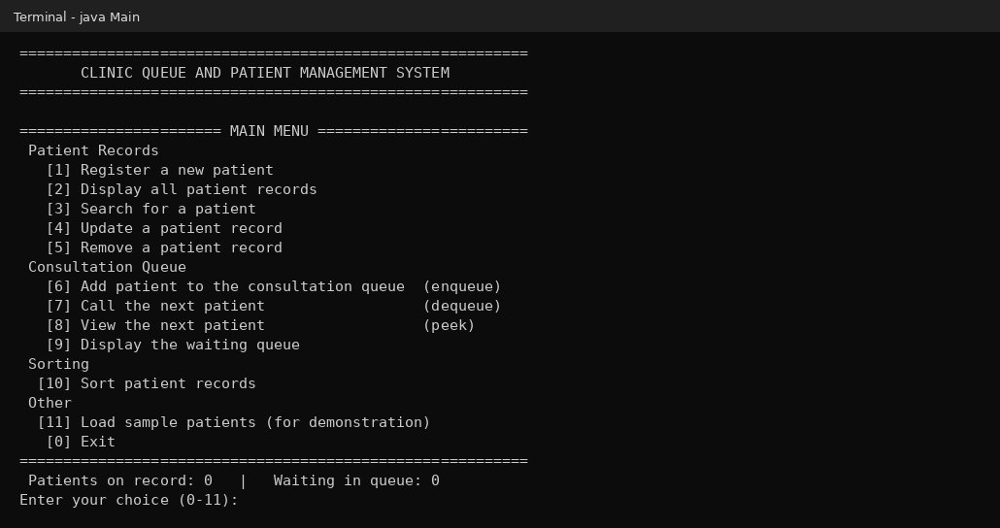

### Adding a record

Registering a new patient. The program assigns the next patient ID and asks whether to add the patient to the queue.

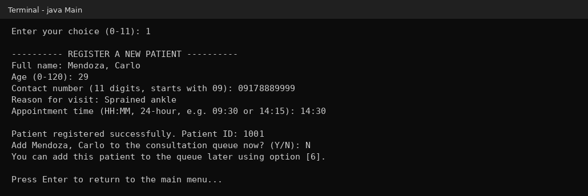

### Displaying stored records

All patient records in a table, including the newly registered patient (ID 1006) after the 5 sample patients.

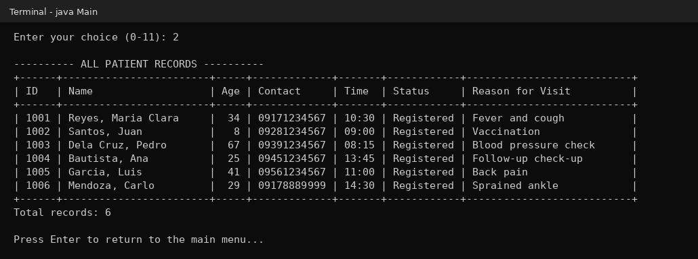

### Searching for a patient

Search by part of a name. The search is case-insensitive and shows the full details of every match.

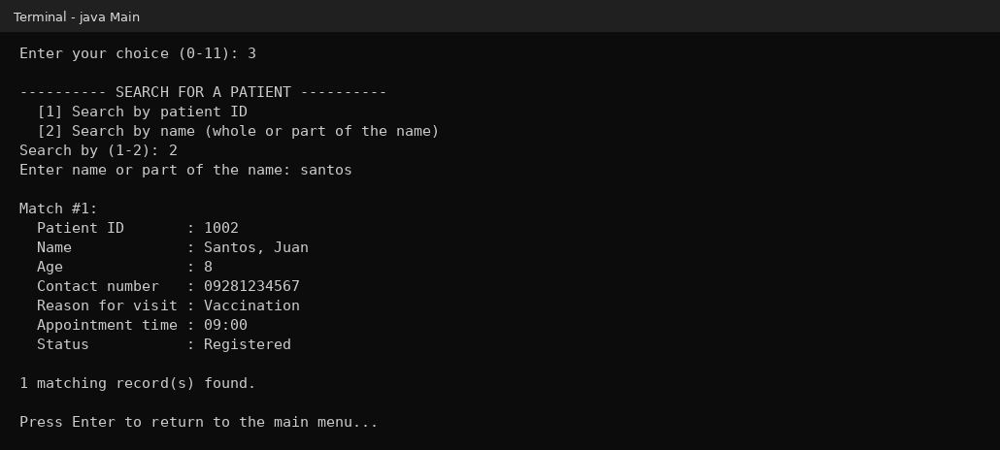

### Queue operation: enqueue

Patients 1003, 1001 and 1005 are added to the queue in that order. Each new patient goes to the back. Trying to add 1001 again is refused because a patient cannot be in the queue twice.

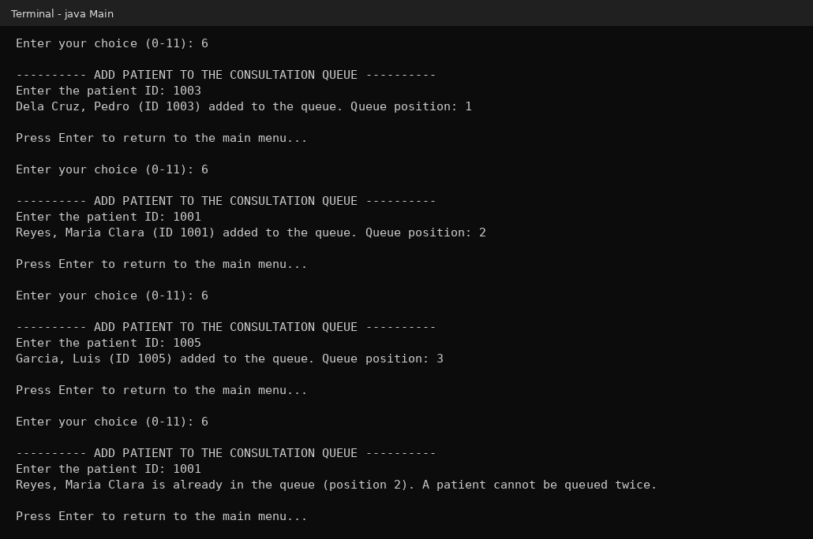

### Queue operation: display the queue

The queue from front (No. 1) to back. The order is exactly the enqueue order: 1003, 1001, 1005.

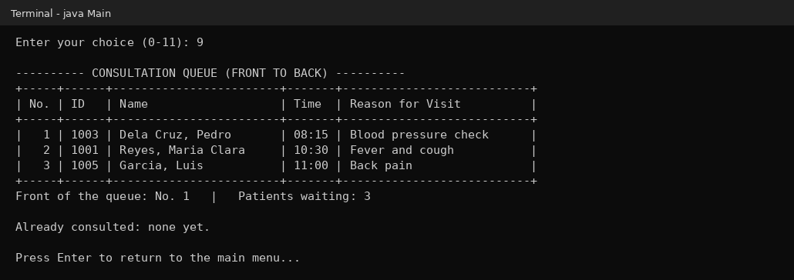

### Queue operation: peek

Peek shows the patient at the front (Dela Cruz, Pedro) without removing him. The queue still has 3 patients.

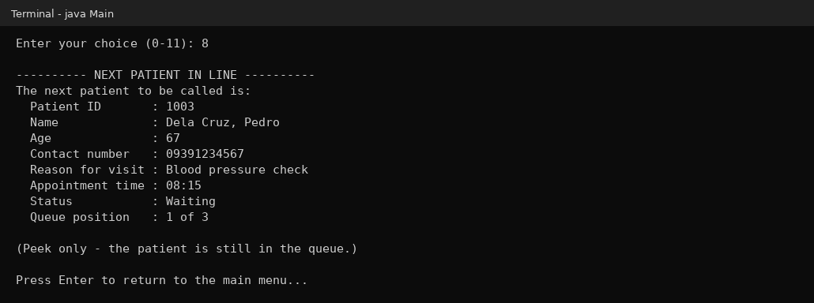

### Queue operation: dequeue

Calling the next patient removes Dela Cruz, Pedro from the front, changes his status to *Consulted*, and announces who is next.

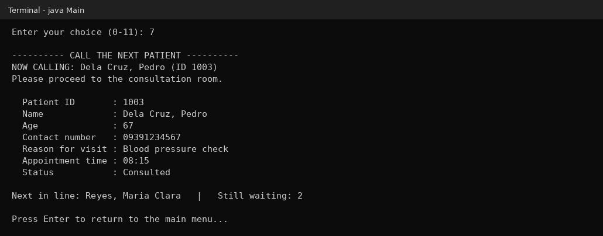

### FIFO behavior

Two patients are called, then the queue is displayed. The patients were consulted in the same order they were enqueued (1003 then 1001), and the last one added (1005) is the only one still waiting.

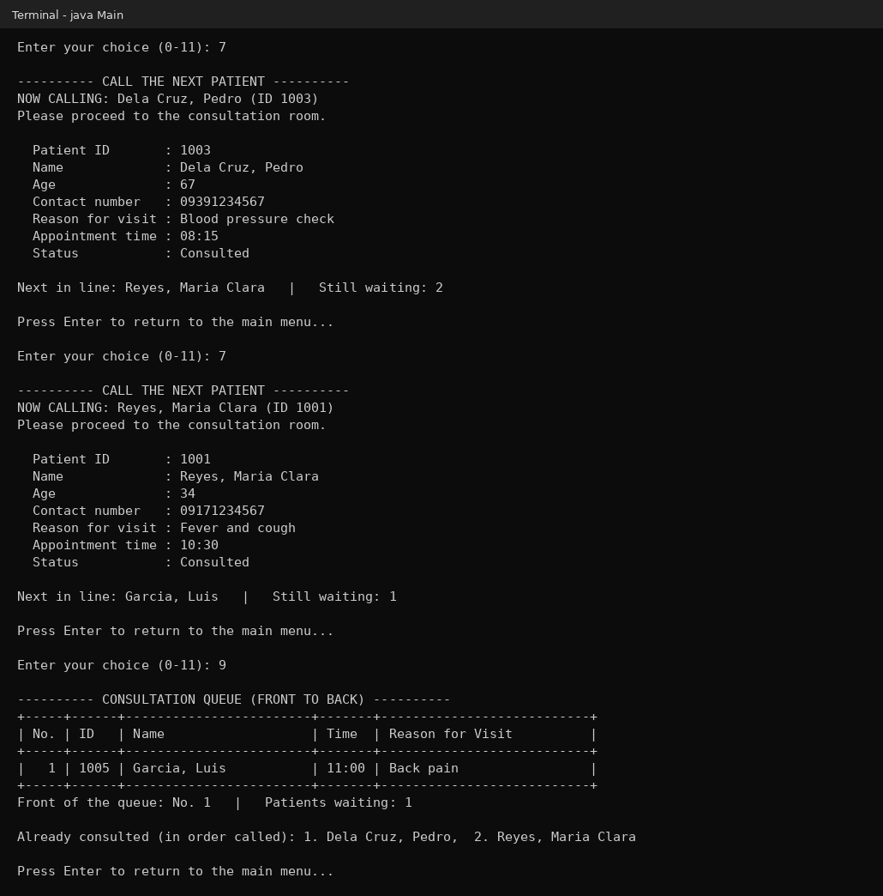

### Sorting algorithm 1: Selection Sort (by name)

Records before and after Selection Sort by name, A to Z.

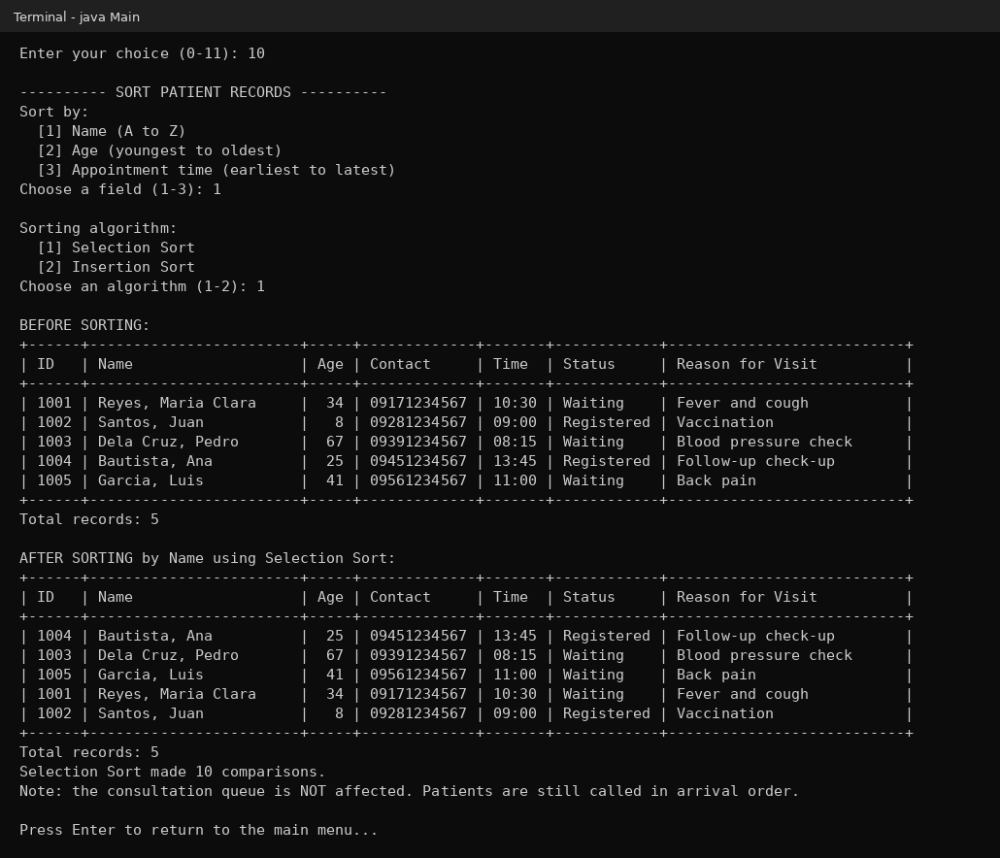

### Sorting algorithm 2: Insertion Sort (by appointment time)

Records before and after Insertion Sort by appointment time, earliest first. The sample list was already close to time order, so Insertion Sort needed only 6 comparisons. Selection Sort always needs 10 for 5 records.

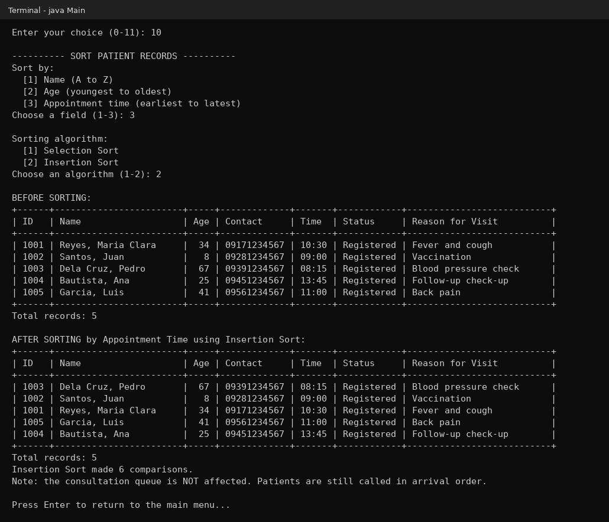

### Sorting does not change the queue

After the records were sorted by name, the queue is displayed again. The calling order is still 1003, 1001, 1005, the order the patients arrived.


### Input validation

Wrong menu entries (text, out-of-range number, blank) and wrong patient details (blank name, digits in a name, text for age, age above 120, badly formatted contact number and time, an answer other than Y/N). Each one prints a message and asks again; the program never crashes.

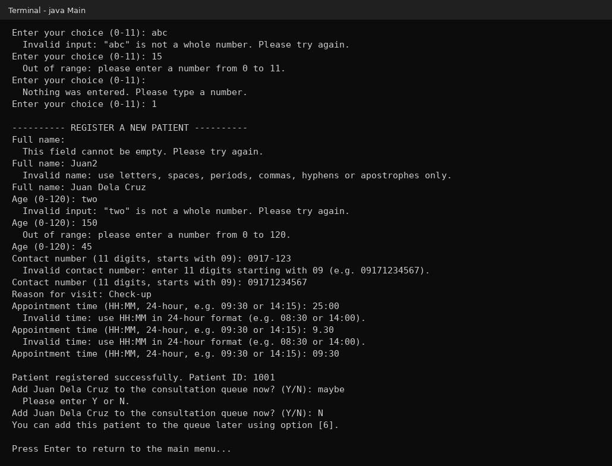

### Empty queue and missing record messages

Calling and peeking when the queue is empty, enqueuing with no patients registered, enqueuing a patient ID that does not exist, and trying to remove a patient who is still waiting.

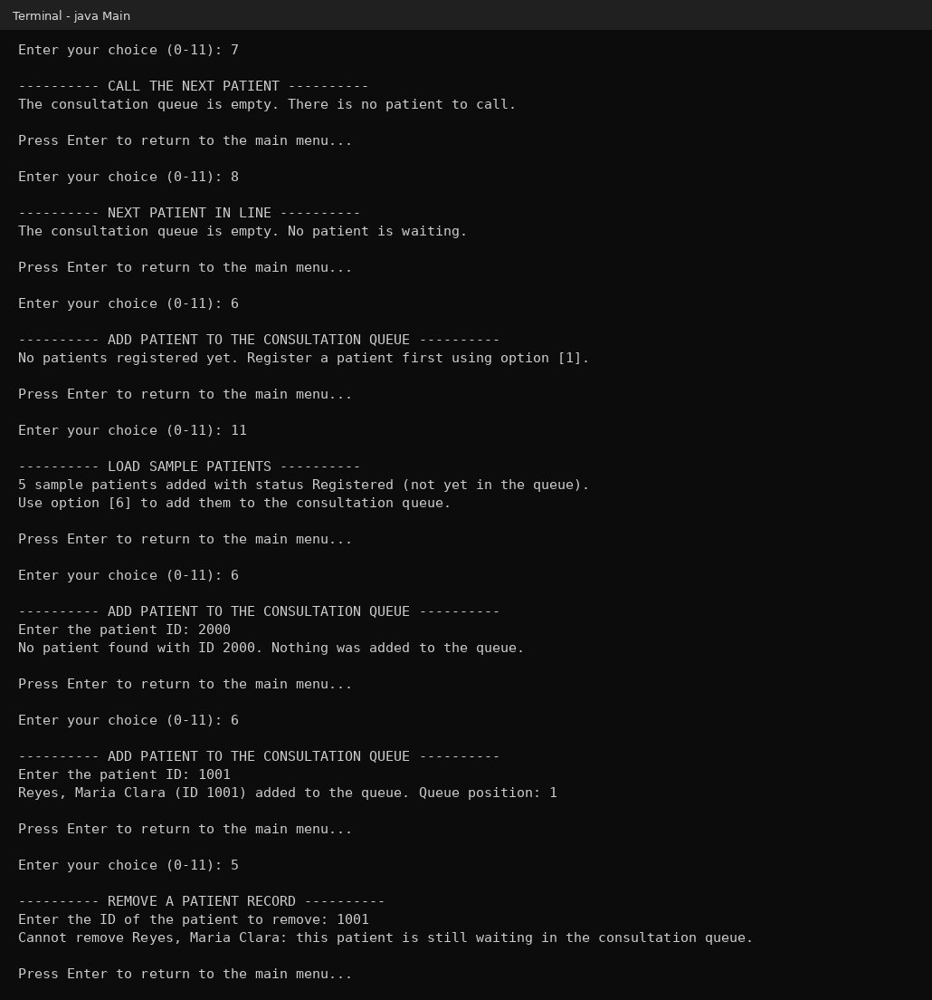

## 8. Project Structure

```
DSA-Java-Sorting-Queue-Capstone/
├── src/
│   └── Main.java          # the whole program (static methods only)
├── screenshots/           # 14 screenshots used in this README
└── README.md
```

Main parts of `Main.java`:

| Section | Methods |
|---|---|
| Menus | `main`, `printMainMenu`, `printBanner` |
| Patient records | `registerPatient`, `addPatientRecord`, `displayAllPatients`, `searchPatient`, `updatePatient`, `removePatient`, `findIndexById` |
| Consultation queue | `enqueuePatient`, `addToQueue`, `callNextPatient`, `peekNextPatient`, `displayQueue`, `getQueuePosition` |
| Sorting | `sortMenu`, `selectionSort`, `insertionSort`, `compareRecords`, `swapRecords` |
| Input validation | `readInt`, `readIntInRange`, `readNonEmpty`, `readName`, `readContactNumber`, `readTime`, `readYesNo` |
